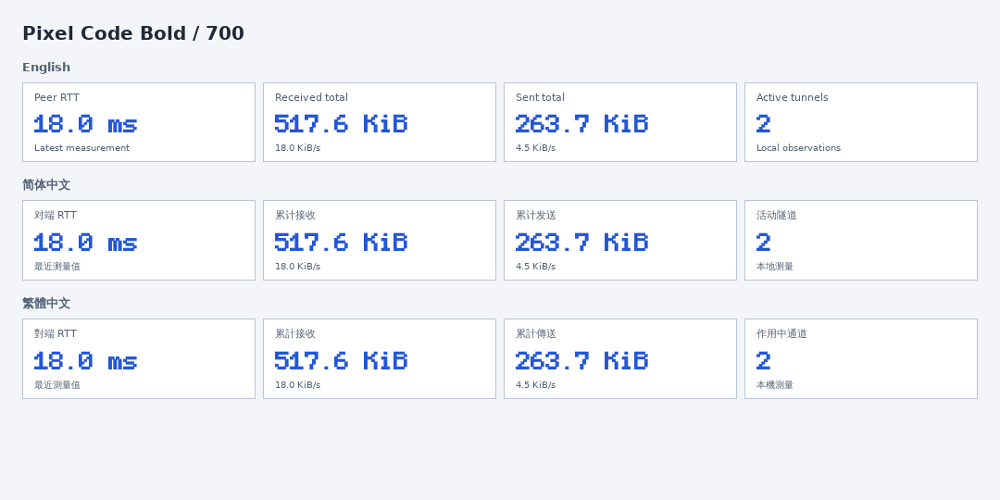
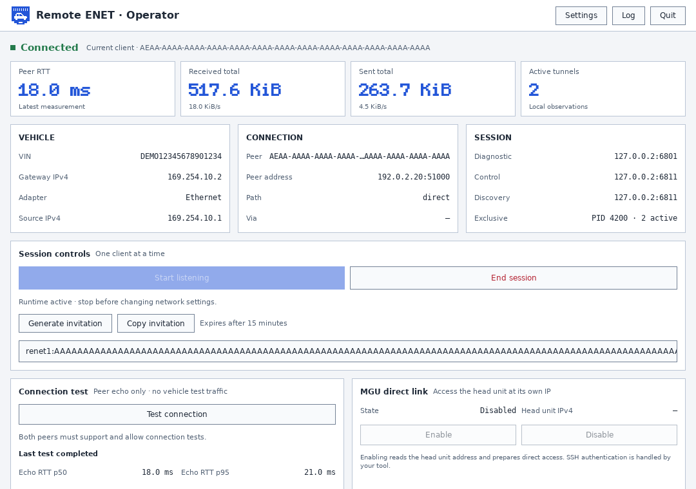
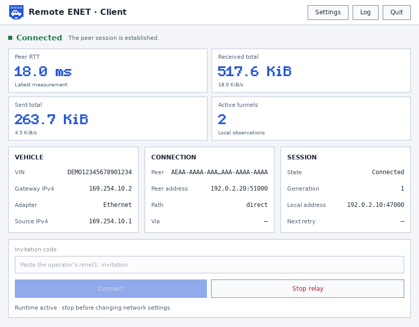

# Remote ENET 视觉规范 · Pixel Workbench

2026-11-18确定，后续Client、Operator、抓取页及新增页面统一遵循。方向为**浅色像素工作台**：像素图形、直角控件、清晰的工程信息层级。它是本项目的设计选择，不表示像素风是整个软件行业的默认风格。

## 调研与取舍

以下选取当前可用的代表方案；适用性是结合本项目多语言、原生桌面、长地址及诊断数据作出的判断，不是市场份额排名。

| 参考 | 可借鉴之处 | 本项目采用方式 |
|---|---|---|
| [NES.css](https://nostalgic-css.github.io/NES.css/) | 明确的8-bit组件轮廓；官方也说明布局需自行定义 | 借鉴硬轮廓与像素符号，保持紧凑的数据布局 |
| [8bitcn](https://www.8bitcn.com/docs)、[按钮](https://www.8bitcn.com/docs/components/button) | 现代组件结构配合复古视觉，有表单、表格、菜单等完整部件 | 作为像素控件语言参考，用现有mygo实现，不引入React或CSS框架 |
| [Carbon间距](https://www.carbondesignsystem.com/building-blocks/foundations/spacing/overview)、[字体](https://www.carbondesignsystem.com/building-blocks/foundations/typography/overview) | 以2/4/8倍数的间距和文字层级组织生产工具 | 采用整数网格、低干扰面板、清晰的标签和等宽数据 |
| [Pixelarticons](https://pixelarticons.com/docs/) | 图标采用固定像素网格，区分不同尺寸用途 | 学习网格和小尺寸辨识原则；品牌Logo自行绘制，不复制第三方标志 |

确定采用现代像素组件的轮廓，配合生产工具的信息布局。避免将日常诊断界面做成游戏HUD、厚重Win95浮雕或装饰性仪表盘。

## 不变原则

- 应用自绘的按钮、输入框、面板、弹层、提示和滚动条使用直角。mygo v0.9.1 内置 Tooltip 的圆角由控件内部设置，主题的 `Radius` 对其无效。
- Client 和 Operator 主窗口均无系统框，外圈绘制 1 DIP 描边，应用页眉空白处可拖动窗口。macOS 上 mygo v0.9.1 的 `Frameless` 仍带系统标题栏样式，内容裁剪无法改变系统窗口和阴影的圆角。应用先隐藏创建窗口，再在 AppKit 主线程移除原生 `NSWindowStyleMaskTitled` 位，保留其余样式位，刷新阴影，待首帧绘制后显示。此实现依赖 mygo 的原生窗口构造、键盘焦点和首帧显示行为，升级 mygo 时需复查。Windows 11 创建窗口后通过 DWM 的 `DWMWCP_DONOTROUND` 关闭系统圆角，Windows 10 使用原有直角。两端均使用 `CornerRadius: 0`。系统对话框和系统图标遮罩由操作系统处理。
- 不使用渐变、玻璃模糊、发光、软阴影、胶囊按钮或装饰性圆点；状态灯使用8×8方块，并保留状态文字。
- 以4 DIP为基础间距，常用4/8/12/16/24/32。普通边框1 DIP，键盘焦点2 DIP；线条对齐像素边界。
- 页面继续使用固定顶栏、概览指标、信息面板和明确操作区；保留既有角色和页面导航，不因换肤改变会话动作。
- 中文正文和操作文字保持系统可读字体；数值、地址、指纹等数据使用等宽字体。像素感来自几何和图标，不牺牲简繁中文可读性。
- 长地址保持中间省略、工具提示或单行滚动；最近帧与日志保持有界列表。缩放和小窗口可滚动，关键操作与返回入口可达。
- Client 窗口固定为 440×700 DIP，不能调整大小或最大化。默认尺寸和 100% 缩放下，headless 测试要求首页容纳一条网卡刷新提示后仍预留至少 24 DIP，以吸收平台字体差异。主屏工作区不足时首次打开收紧，不低于 420×480 DIP，内容纵向滚动。Operator 仍可调整大小。网卡和刷新同一行，邀请码和连接按钮各占一行，窄布局的车辆、连接、会话详情共用一张卡片。逻辑宽度低于 360 DIP 时，Client 指标改为一列，以便放大后仍能读出数值和单位。

## 颜色与文字

配色以`internal/ui/theme.go`为实现依据，Logo强调色来自`internal/brand`。

| 用途 | 色值 |
|---|---|
| 工作区 / 面板 / 输入表面 | `#F3F5F8` / `#FFFFFF` / `#F8FAFC` |
| 正文 / 次级文字 | `#1F2937` / `#526174` |
| 面板边界 / 控件边界 | `#BAC5D5` / `#748296` |
| 强调 / 悬停 / 按下 | `#2356D8` / `#1D48B9` / `#173A97` |
| 成功 / 等待 / 错误 | `#237A4B` / `#8A5700` / `#B42332` |
| 信息 / 等待 / 错误表面 | `#EAF0FF` / `#FFF4D6` / `#FDECEF` |

正文基准12 DIP，标签和辅助说明11，次要测量注释可用10；标题16。顶部四项主指标采用24 DIP的[Pixel Code Bold](https://github.com/qwerasd205/PixelCode)真实700字重，保持等宽并关闭`calt`/`liga`；像素字体仅用于大数值与英文单位，标签及正文继续使用系统字体和翻译。指标区宽度不足840 DIP时改为两列，避免放大后截断。其他主要数据继续使用现有等宽字体。新控件复用Theme与现有card/value/metric，新增颜色应有明确语义，不按页面另配主色。

Pixel Code固定使用v2.2原版Bold字体，采用SIL Open Font License 1.1，来源、校验值与完整许可位于[`internal/ui/assets/fonts/pixel-code`](../internal/ui/assets/fonts/pixel-code/README.md)。字体内嵌到应用，四份平台/角色包均附带许可；数值、`ms`、`KiB`等单位和占位符不经过汉化。Departure Mono常规字重探索稿已移除。



按[WCAG 2.2对比度目标](https://www.w3.org/WAI/WCAG22/Understanding/contrast-minimum.html)检查启用状态文字4.5:1、功能边界/焦点3:1。面板细分隔线用于分组，不代替控件边界；状态和错误不只依赖颜色。

## Logo · RJ45 Car

用户已确定采用[实色RJ45端口与白色侧视小车细化稿](design/logo-variants/rj45-sidecar/refined/README.md)，现已替换两端应用资源：钴蓝实底、白色触点、车身与车轮，阶梯前窗和底部卡扣保持像素网格。16px将触点归并为四组像素，20/32px保留八枚。


上一版Car Bridge保存在[SVG](design/logo-variants/car-bridge-v1.svg)与[PNG](design/logo-variants/car-bridge-v1.png)；更早的双端桥接与云车候选也保留供比较。它们不再作为当前应用几何源。

- 主几何源：`internal/brand/assets/mark.svg`，32×32整数网格；小尺寸源为同目录的`mark-16.svg`和`mark-20.svg`，仅矩形与纯色。
- 颜色固定为钴蓝`#2356D8`与白色`#FFFFFF`。全彩版的小车与触点为不透明白色；单色版将白色区域转为透明留白，保留网口与车窗的黑色Alpha。
- 标志最小16px。16/20px分别使用独立网格；48px使用16格稿的3倍整数放大，64px等使用32格主稿整数放大。禁止拉伸、旋转、加光晕或平滑缩放位图。
- 页眉使用原生32px PNG；窗口与任务栏使用统一主稿，打包资源包含独立小尺寸。Windows托盘使用16px彩色稿；macOS不设菜单栏图标，Dock即常驻入口。
- macOS的ICNS使用`app-icon-macos.png`：按[Apple图标规范](https://developer.apple.com/design/human-interface-guidelines/app-icons)的网格（1024画布内缩100；圆角用超椭圆近似系统连续圆角，起弯270、指数3.5，比半径185的圆弧收得更紧）绘制圆角底板，自上而下由白色渐变到混入25%钴蓝的浅色，标志占画布5/8居中（256px起用32格主稿，64/128px用20格稿），各尺寸仍为整数像素；标志的钴蓝部分按网格逐行自上而下由天蓝`#4296F6`过渡到靛蓝`#3034E8`，每个像素格保持单色，白色触点与小车不变；仅底板边缘抗锯齿。直接打包的ICNS不会被系统套用遮罩，圆角与留白须自带。运行时不再调用`Dock.SetIcon`，启动跳动与运行中的Dock图标都来自同一ICNS。ICNS只含64–1024px，16/32px由系统从64px缩小。这是界面“直角、无渐变”规则对系统应用图标容器的唯一例外。
- Logo透明版用于页面与文档，浅色方底版用于应用图标，黑色Alpha单色模板作为品牌交付物保留。

生成可交付SVG、PNG、ICO与ICNS：

```sh
CGO_ENABLED=0 go run ./internal/brand/cmd/brandassets --output internal/brand/assets --windows-resource internal/brand/icon_windows_amd64.syso
```

页眉、窗口/任务栏、Dock和托盘复用该品牌源。macOS包附AppIcon.icns；Windows包提供RemoteENET.ico，并由纯Go生成的COFF资源`internal/brand/icon_windows_amd64.syso`将同一组图标嵌入EXE，覆盖资源管理器及快捷方式的图标。生成过程不依赖cgo或外部资源编译器。

## 审阅预览

使用合成数据生成，不代表真实车辆连接或测量。





## 后续执行规则

新增页面先复用主题、4 DIP间距和直角组件，再增加业务内容；新图标采用整数像素网格。每次视觉改动至少检查两端主页面、Settings、Log、Capture、简繁中文与英文，以及100%/150%和最小尺寸。可逆视觉调整复用现有交互门禁，不为单个颜色常量添加机械测试。

此前[浅色配色研究](research/ui-light-theme.md)作为历史记录保留；与本规范冲突时，以本规范为准。图像探索与最终资产制作过程见[品牌记录](research/pixel-brand-notes.md)。

## 首版验证

全仓gofmt/vet/test、ui/desktopui/brand相关race及80项离线工具测试通过。像素资产回归检查透明Alpha仅0/255、单色轮廓一致、导出资源与SVG同步及ICO/ICNS容器可解码。9组主要颜色对中，普通文字最低4.859:1，控件边界3.733:1；分组细线不作为功能控件边界。

两端Main/Settings/Log及150%预览已生成，既有小窗口和多语言交互回归通过。Windows普通用户启动新Operator，确认简中界面、直角面板和键盘焦点、页眉/窗口/任务栏Logo及Settings/Log导航；没有启动网络会话或创建TUN，正常退出并回收临时task。macOS本轮仅完成arm64构建和包图标资源校验，未声称实机渲染通过。

四份首版预览包版本为`0.1.0-preview.wave14.0-worktree`，位于`dist/`与`/tmp/remote-enet-wave14/preview/`；该验收记录生成于提交前。

车辆元素追加版为`0.1.0-preview.wave14.1-worktree`；Logo源与SVG/PNG/ICO/ICNS导出同步更新，原始字节、交互和主题不因Logo修订改变。

## 当前应用资源验证

RJ45 Car已接入两端页眉、窗口、Dock、托盘及打包资源，顶部四项主数值采用Pixel Code Bold 700。独立16/20/32px彩色与单色图、macOS菜单栏2倍模板以及多尺寸ICO/ICNS同步生成。Windows两端EXE的实际`.rsrc`均已解析，确认七种尺寸的RT_ICON与RT_GROUP_ICON逐项匹配同源ICO。

全仓gofmt、vet、test、brand/资源生成器/ui/desktopui相关race及80项离线工具测试通过。像素网格回归检查纯色Alpha和白色模板留白；字体回归确认内嵌字体注册、固定数字字宽，以及简中/繁中/英文与100%/150%下的数值、单位和显示边界。新页眉、主界面和三语言指标预览已更新。

四份`0.1.0-preview.wave14.3-worktree`包已在`dist/`生成，逐项核对了包摘要、manifest文件哈希、ICNS/ICO、Windows EXE内嵌图标和字体版权许可。macOS本轮仅完成arm64构建和资源校验；Windows原生取图脚本被测试机PowerShell执行策略阻止，未修改该策略，本轮未声称新图标或新字体已通过原生界面验收。此前原生验收属于旧版资源。

提交和推送按用户明确指令执行，对应提交的CI结果另行核对。
