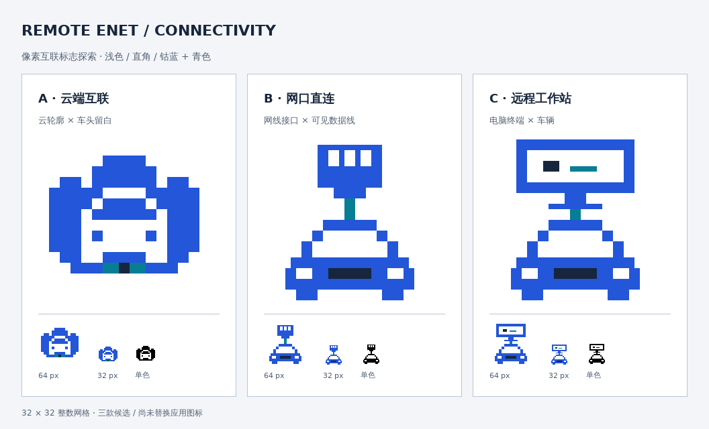
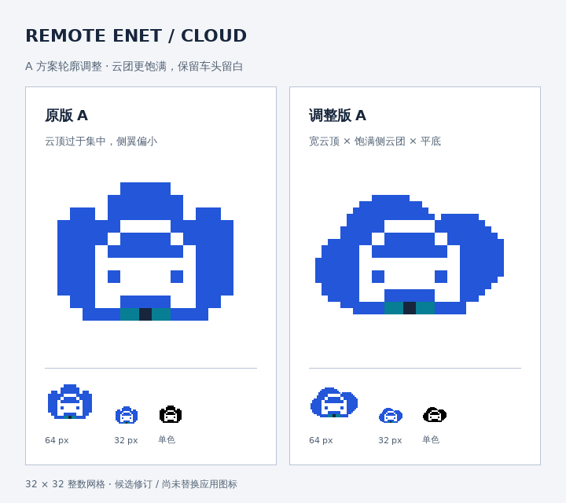

# 互联元素对照

本轮按“融入云、接口或者电脑，体现互联”的追加要求，直接绘制可编辑SVG候选。延续浅色像素工作台的钴蓝、青色、纯色矩形与整数网格。本目录为构图对照，不替换当前应用资产。

## A轮廓修订

原版A的中央云顶偏高、两侧云团偏小，容易读成山峰。追加[云团修订稿](cloud-revision/cloud-car-puffs.svg)：压低主云顶，改为略不对称、相互重叠的饱满云团与平底。外轮廓仍由整数像素阶梯组成，保留车头留白与底部青色连接。

[浅底PNG](cloud-revision/cloud-car-puffs.png) · [透明PNG](cloud-revision/cloud-car-puffs-transparent.png) · [32px单色](cloud-revision/cloud-car-puffs-mono-32.png)。原版A保留供对照，修订稿尚未替换生产资产。

| 方向 | 含义与取舍 | 矢量源 |
|---|---|---|
| A · 云端互联 | 云为外轮廓，车头为内部留白，青色连接收进底边；整体性更强，优先推荐。云是远程网络的视觉隐喻。 | [SVG](cloud-car.svg) |
| B · 网口直连 | 网线接头通过可见青色线缆接入车辆；连接含义直接，细节更多。 | [SVG](port-car.svg) |
| C · 远程工作站 | 电脑终端与车辆上下连接，强调诊断工具场景；两个主体更容易形成示意图观感。 | [SVG](computer-car.svg) |

每款保留512px浅底PNG、透明PNG、32px彩色与单色样张；对照板另按64px、32px原生尺寸显示。候选使用32×32网格，16px正式资产须在定稿时单独简化，不能直接缩小位图。

本轮为代码原生矢量绘制与确定性栅格导出，未使用图像生成工具；未改生产Logo源、托盘或打包资源。
