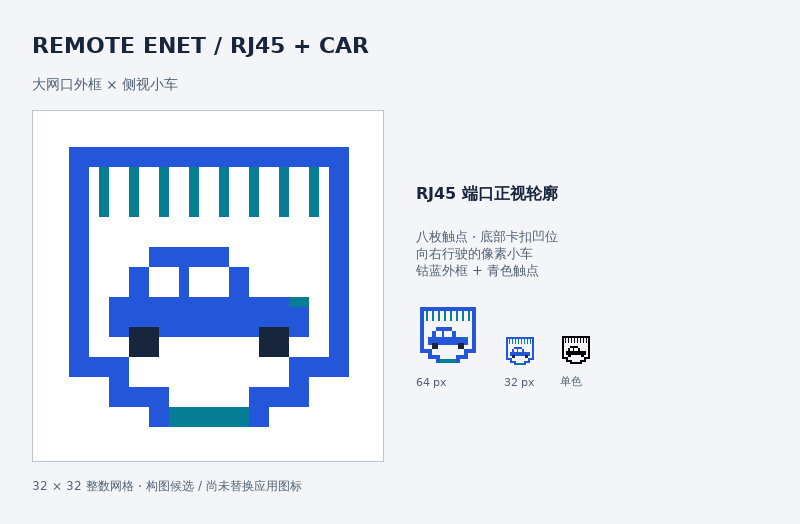
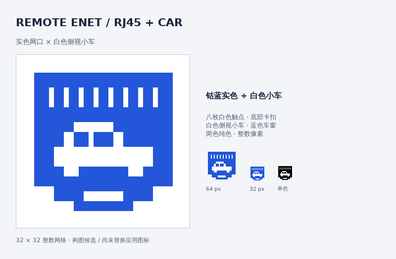
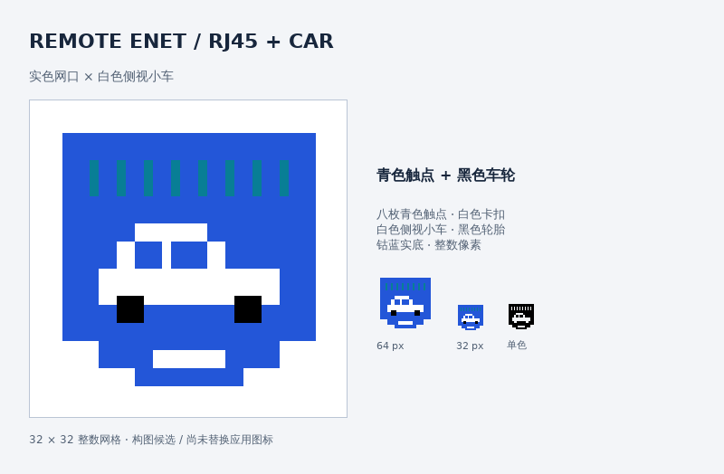
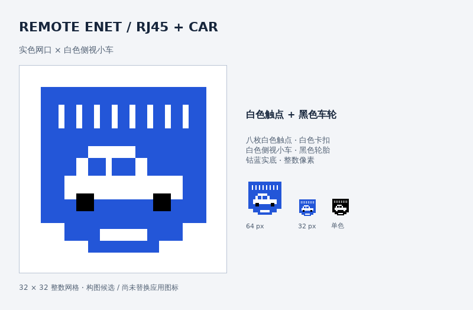

# RJ45端口与侧视小车

当前采用[细化稿](refined/README.md)：钴蓝实底、白色触点与白色车轮，整理车头与卡扣，并提供独立16/20/32px网格、单色模板和ICO/ICNS。用户已确认替换两端应用图标，正式源位于`internal/brand/assets`；以下早期构图与配色保留供比较。

按用户提出的“大RJ45端口作为背景，里面是一辆侧视小车”绘制新构图。外框采用网口正视轮廓、八枚青色触点与底部阶梯卡扣凹位；开口内放置朝右的钴蓝像素小车，保留两扇窗、两只方形车轮与一处前灯。

- [可编辑SVG](rj45-sidecar.svg)
- [512px浅底PNG](rj45-sidecar.png)与[透明PNG](rj45-sidecar-transparent.png)
- [64px](rj45-sidecar-64.png)、[32px](rj45-sidecar-32.png)与[32px单色](rj45-sidecar-mono-32.png)

沿用浅色像素工作台的钴蓝、青色与深蓝，采用32×32整数网格，仅使用纯色矩形。SVG与PNG由同一组像素几何导出，本轮没有使用图像生成工具。

本稿为构图候选，尚未覆盖生产Logo、托盘或打包资源。16px正式资产须在定稿时单独简化，不能直接缩小位图。

## 实色底与白色小车

按追加意见改为钴蓝实色端口、白色侧视小车和触点，车窗保留蓝色，取消青色与深蓝细节。两色版保留原端口外轮廓及小车比例，单色样张将白色部分作为透明留白。

[SVG](solid/rj45-sidecar.svg) · [浅底PNG](solid/rj45-sidecar.png) · [透明PNG](solid/rj45-sidecar-transparent.png) · [32px单色](solid/rj45-sidecar-mono-32.png)。透明PNG仅外围透明，小车与触点仍为不透明白色。本版另存为候选，未覆盖原外框版或生产资源。

## 青色触点与黑色车轮

按追加意见恢复触点原色`#087E95`，两只车轮改为纯黑`#000000`。保留钴蓝实底、白色车身、蓝色车窗与白色卡扣，几何不变。单色样张将触点和整辆小车统一作为透明留白，保留小尺寸辨识。

[SVG](solid-accent/rj45-sidecar.svg) · [浅底PNG](solid-accent/rj45-sidecar.png) · [透明PNG](solid-accent/rj45-sidecar-transparent.png)。本版另存为候选，未替换生产资源。

## 白色触点与黑色车轮

此前将八枚触点换回白色，保留黑色车轮、白色车身和钴蓝实底，几何不变。用户随后将轮子也换回白色，当前审阅版见文首。

[SVG](solid-white-contacts/rj45-sidecar.svg) · [浅底PNG](solid-white-contacts/rj45-sidecar.png) · [透明PNG](solid-white-contacts/rj45-sidecar-transparent.png)。本版另存为候选，未替换生产资源。
