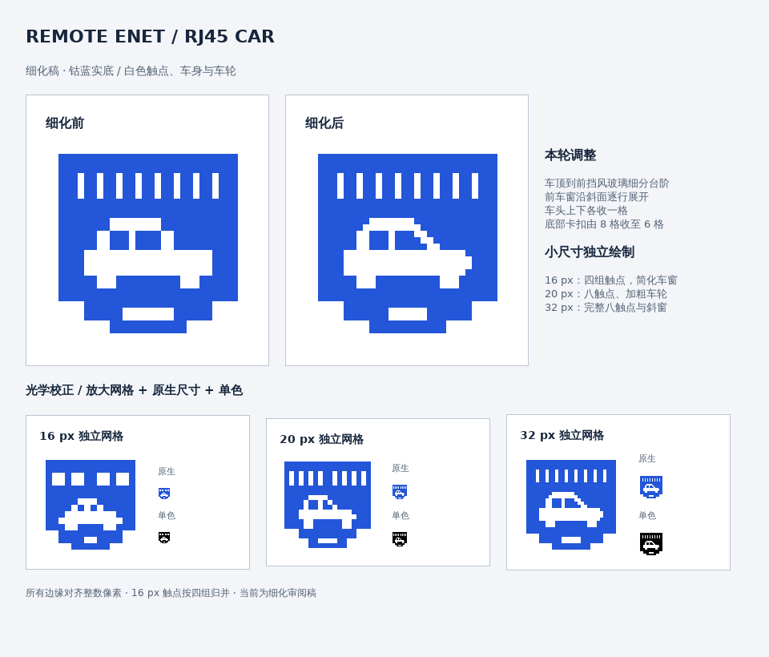

# RJ45 Car细化稿

构图与配色保持为钴蓝实色端口、白色触点及侧视小车。本轮按已确认的三项细化方向完成几何整理和小尺寸适配。

## 几何调整

- 车顶至前挡风玻璃改为逐行像素台阶，前车窗沿台阶展开，突出朝右的侧视轮廓。
- 车头上、下边各收一格，白色车轮与车身保持连接。
- 32格主稿的底部白色卡扣从8格收至6格，保留与车轮之间的蓝色留白。

## 独立网格

| 尺寸 | 处理 | 源文件 | 彩色 | 单色模板 |
|---|---|---|---|---|
| 16px | 八枚触点归并为四组像素；车窗和轮子简化至完整像素 | [SVG](mark-16.svg) | [PNG](icon-16.png) | [PNG](template-16.png) |
| 20px | 八枚触点保留，中央间距校正；轮子为2×2像素 | [SVG](mark-20.svg) | [PNG](icon-20.png) | [PNG](template-20.png) |
| 32px | 完整八枚触点、阶梯前窗及3格宽车轮 | [SVG](mark-32.svg) | [PNG](icon-32.png) | [PNG](template-32.png) |

三个网格独立绘制；不对32px位图直接缩放。48px使用16格稿的3倍整数放大；64px及更大常规尺寸使用32格主稿整数放大。全彩版外围透明，小车和触点为不透明白色。单色模板把小车、触点和卡扣转为透明留白，其余为黑色Alpha，供系统按明暗主题着色。

## 交付文件

- [主稿SVG](logo.svg)、[1024px透明PNG](logo.png)、[1024px浅底图标](app-icon.png)。
- [Windows ICO](app-icon.ico)：内含16、20、32、48、64、128、256px，16与20px使用独立网格。
- [macOS ICNS](app-icon.icns)：内含16、32、64、128、256、512、1024px，16px使用独立网格。

已核对SVG与各尺寸PNG逐像素一致、Alpha仅为0/255、触点组数、单色模板留白，以及ICO/ICNS全部图层的尺寸与内容。审阅板使用mygo headless生成，含原生尺寸与整数放大图；本轮未进行Windows/macOS原生窗口验收。

用户已确认本版并替换两端应用图标。正式源位于`internal/brand/assets/mark.svg`、`mark-16.svg`和`mark-20.svg`；后续以正式源与统一生成器为准。页眉、窗口、Dock、托盘和打包图标已接入；Windows EXE额外通过同源COFF资源嵌入图标。macOS托盘从20格稿裁去透明边距，以36px模板适配18点菜单栏。前几轮候选保留在上级目录。
